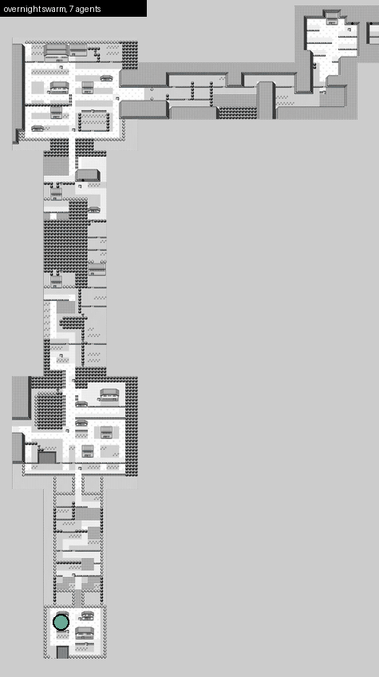

# Trailswarm

Trailswarm is a rule-based agent that plays Pokemon Red through the PyBoy emulator. It reads the game's own data (RAM, the tile map, ROM tables), learns the world into a shared map memory, and runs as a swarm of parallel headless agents that you can watch and steer from a desktop viewer.

The Python package and CLI are still named `pokeagent` (`uv run pokeagent ...`); the project was renamed from PokeAgent on 2026-11-06.



*Seven real overnight explore runs replayed on the ROM-rendered Kanto map, Pallet Town to Mt Moon, with trails; hollow circles are agents indoors.*

## Highlights

- A continuous overnight swarm of 8 agents finished 500 runs and reached Cerulean City, beat Misty, and crossed Nugget Bridge (Route 24). It is currently stuck before Bill's house.
- Mt Moon was traversed on 3 of 3 seeds (earlier harness), using collision data read from the ROM and a multi-floor planner.
- Waiting for the battle prompt arrow instead of pressing through scrolling text cut steps to Pewter by about a third (1847-2006 vs 2630-2953), and Brock fell inside 3,000 steps on 2 of 3 seeds.
- No-op A presses per run fell from about 198 to 16-31 after a readiness fix.
- Emulation is not the bottleneck: a lean headless environment runs about 1,000 steps/s at agent pacing (measured in [EXPLORATION.md](EXPLORATION.md)).

Details, dates and caveats are in [docs/RESULTS.md](docs/RESULTS.md).

## How it works

**Explorer backbone with behaviours.** Each step, an ordered list of small behaviours (`src/pokeagent/explorer/behaviours/`) is tried in turn and the first one that applies picks the button: readiness, battle, menus, healing, catching, goto, replaying known beats, planning toward a goal, and frontier exploration as the fallback. Each behaviour is one module with one job, and every decision is logged with its reason.

**Goal ladder.** Progress is measured against a chain of 128 goals from New Game to Hall of Fame, stored as data in `src/pokeagent/data/campaign.json`. Each goal has a RAM-based detector (map entered, badge bit, item in bag, and so on). Goals that need abilities the agent lacks (Cut, Surf, puzzle mazes) are tagged and never targeted. See [docs/campaign_goals.md](docs/campaign_goals.md).

**Segment curriculum with checkpoints.** A segment is the stretch between two goals. The first time a run reaches a goal it saves an emulator state under `runs/checkpoints/`. The curriculum then starts each job from the previous segment's best checkpoint and stops when its own goal lands, so a hard segment can be retried many times without replaying the opening. Slots go mostly to unsolved segments, some to the frontier, some to polishing. A faster solve only counts once a re-run with the same inputs reproduces it, and a segment that keeps failing is split at the maps its failures reached. See [docs/SEGMENTS.md](docs/SEGMENTS.md).

**Continuous swarm.** `tools/swarm.py --continuous` keeps N headless agents running. When one exits, its learned map memory is merged into the shared `runs/maps.json` and a replacement starts from the merged memory. A supervisor upgrade can adopt live agents without stopping them. A stall watchdog frees a slot when an agent is alive but stuck: no new transition for two minutes, or 600 presses with no new goal and almost no new tiles.

**World view.** A Dear PyGui viewer shows every registered agent: a grid of cards, a focus view for one agent (screen, what it sees, what it is thinking, goal progress), and a World view that draws all agents on one map of Kanto rendered from the ROM.

**Intervention tools.** `tools/agentctl.py` lets you or Claude read any live agent and step in safely. `ls` ranks agents by progress, `show` prints a detailed block, `hold` takes a time-limited lease so the agent makes no decisions of its own, `nudge` does a short hold plus a back-out, and `macro` runs a named multi-press routine under the lease. Every intervention is journaled to `runs/agent_interventions.jsonl`.

## Setup

You need Python 3.12 and [uv](https://docs.astral.sh/uv/).

```
uv sync
```

**Bring your own ROM.** No ROM or game asset is included or distributed, and none should ever be committed. Put your legally obtained ROM at `roms/Pokemon Red.gb`, or point `--rom` / `$POKEAGENT_ROM` at it. The verified ROM is Pokemon Red (UE), SHA-1 `EA9BCAE617FDF159B045185467AE58B2E4A48B9A`.

```
uv run pokeagent check-rom             # verify the SHA-1 and that it boots
uv run python tools/make_baseline.py   # writes baselines/bedroom.state (the start of the game)
```

`baselines/`, `roms/` and `runs/` are git-ignored.

## Quickstart

```
uv run pokeagent state                                     # boot headless, print the RAM state summary
uv run python tools/explore_demo.py --steps 400            # watched run of the explorer (PyBoy window)
uv run python tools/explore_demo.py --headless --steps 400 # same, no window, full speed

uv run python tools/swarm.py --agents 4 --steps 400                      # one batch of parallel headless agents
uv run python tools/swarm.py --continuous --plan curriculum --agents 4   # self-refilling curriculum swarm
                                                           # stop it with Ctrl+C or by creating runs/swarm.stop

uv run pokeagent view                           # desktop viewer for registered agents
uv run pokeagent world                          # open the viewer in World mode
uv run python tools/agentctl.py ls              # list live agents
uv run python tools/agentctl.py nudge closest   # nudge the furthest agent
uv run python tools/status.py                   # progress numbers
uv run python tools/segments.py                 # segment curriculum report
```

`pokeagent view --fake 3` and `pokeagent world --fake 3` show animated fake agents, so you can try the viewer without a ROM. `pokeagent world --png out.png` renders the world map headless.

There is also an LLM backend (`uv run pokeagent run --backend claude --steps 50`; one `claude -p` call per step, `--steps` required) and an MCP server (`uv run pokeagent mcp`, configured in `.mcp.json`) that exposes the emulator as tools. `--backend stub` runs the loop with no model.

## Project layout

```
src/pokeagent/
  explorer/        engine, behaviours, battle logic
  intervene/       lease, macros and the client behind agentctl
  viewer/          Dear PyGui viewer (grid, focus, world panels)
  world/, atlas/   ROM-rendered world map and overlays
  knowledge/       battle math and ROM-derived tables
  ramlab/          RAM discovery tooling
  data/            campaign.json (goal ladder), RAM maps
tools/             swarm, curriculum, agentctl, status, ROM and RAM utilities
tests/             unit tests (no ROM or model needed)
docs/              design notes, results, directives
```

## Docs

- [docs/RESULTS.md](docs/RESULTS.md): overnight and benchmark results
- [docs/campaign_goals.md](docs/campaign_goals.md): the 128-goal ladder and its detectors
- [docs/SEGMENTS.md](docs/SEGMENTS.md): segments, checkpoints and the curriculum
- [docs/KNOWLEDGE.md](docs/KNOWLEDGE.md): verified facts about the ROM and RAM
- [docs/ROADMAP.md](docs/ROADMAP.md): layers, prior art and phases
- [DIRECTION.md](DIRECTION.md) and [EXPLORATION.md](EXPLORATION.md): current direction and experiment log
- `docs/directives/`: the per-feature build specs

## Tests

```
uv run pytest -q
```

Tests run without a ROM or a model. Tests that need a real ROM skip unless `POKEAGENT_ROM` points at one.

## Credits and legal

RAM labels in `src/pokeagent/data/ram_map.json` are derived from pret/pokered's `pokered.sym`. That repository publishes no licence file, so the symbol file itself is not redistributed here.

This project is unaffiliated with and not endorsed by Nintendo, Game Freak, Creatures Inc., The Pokemon Company, or any other game publisher. All game titles and characters belong to their respective owners. No ROM or other game software is distributed with this repository, and none ever will be.

The [MIT License](LICENSE) covers only the original code and documentation written for this project. It grants no rights in any game, trademark or third-party work. See [docs/LEGAL.md](docs/LEGAL.md) for the project policy and third-party notices.
